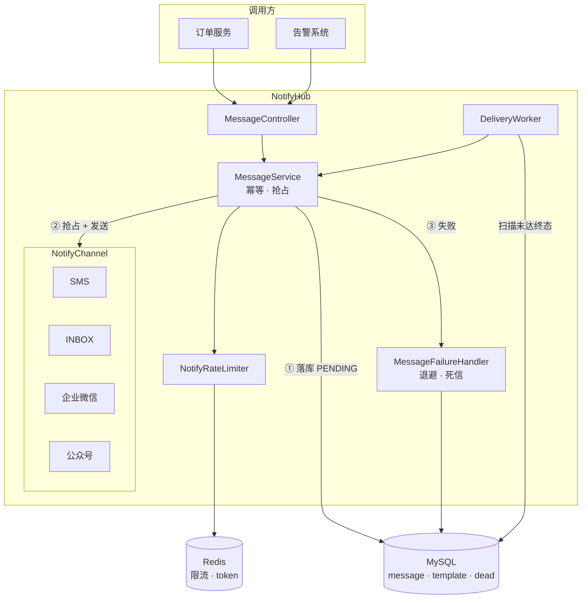

# NotifyHub · 通知中台

一个统一的消息投递服务：业务方调一次接口，它负责把消息**可靠地**送到短信、站内信、企业微信、公众号。

核心不是"能发出去"，而是**发失败之后怎么办**——重试多少次、隔多久重试、彻底失败后怎么兜底、人工修复后怎么补发。

---

## 它解决什么问题

调用第三方通道一定会失败：短信网关抖动、微信接口限流、网络超时。朴素的写法是"调一次，失败就抛异常给业务方"，结果是：

- 业务方（订单、告警）被通知的可用性绑架，通知失败连带业务回滚
- 失败消息彻底丢失，用户永远收不到
- 重试打爆通道配额，一次故障放大成大故障

NotifyHub 把这件事收敛成：

```
业务方提交 → 落库（PENDING）→ 立即投递一次
                ↓ 失败
         按指数退避写入下次投递时间 → 定时任务补偿
                ↓ 超过最大次数
         转死信 + 保留完整失败原因 → 人工确认后一键重放
```

**与 CodeJudge（项目一）的分工**：项目一解决"任务怎么高效分发"（Redis Stream 消费者组），本项目解决"消息怎么保证送达"（状态机 + 补偿 + 死信）。前者是吞吐问题，后者是一致性问题。

---

## 核心能力

| 能力 | 实现 |
|---|---|
| **可靠投递** | 本地消息表 + 定时补偿，不依赖 MQ 也不丢消息 |
| **幂等** | 唯一键 `uk_biz_channel(biz_id, channel)`，捕获冲突而非先查后插 |
| **防止重复投递** | 条件更新抢占 `WHERE status IN ('PENDING','FAILED')`，影响行数为 1 才执行 |
| **失败重试** | 指数退避 `base × 2^(n-1)`，上限可配，退避时间由**数据库时钟**计算 |
| **死信** | 重试耗尽转 `DEAD` + 落 `message_dead` 表，保留完整上下文，支持重放 |
| **通道可插拔** | `NotifyChannel` 策略接口，新增通道 = 加一个实现类，主流程不动 |
| **微信 access_token** | Redis 缓存 + 提前刷新 + SETNX 分布式锁；**缓存 key 按 appId 分桶**，多公众号互不踢 token |
| **限流** | 按接收方（防短信轰炸）+ 按通道（控成本），Redis Lua 固定窗口 |
| **管理台** | 独立前端工程（Vue3 + TS + Vite），左侧导航：发送消息 / 管理对象 / 通道账号 / 消息查询 / 死信 |
| **发送对象** | 接收方地址簿：一次录入长期复用；发送时只传 `recipientId`，通道与地址由服务端解析 |
| **多通道账号** | 凭据入库可增删改查，一个对象绑定一套账号；新增公众号不用改配置重启，密钥列表脱敏 |

通道实现：

| 通道 | 说明 |
|---|---|
| `INBOX` | 站内信，落库即送达，地址填用户 ID |
| `SMS` | mock 实现，地址填手机号，可配失败率与延迟用于验证重试链路 |
| `WECHAT_WORK` | 企业微信群机器人。地址栏填群机器人 Webhook（`https://qyapi.weixin.qq.com/cgi-bin/webhook/send?key=xxx`），一个群建一个对象即可分别发送；不填则回落到全局 `WECHAT_WORK_WEBHOOK` |
| `WECHAT_MP` | 公众号模板消息，地址填 openid，需认证服务号资质 |

> **个人微信群发不了**：微信没有开放任何面向个人群的发送接口，
> 网上流传的 itchat / wechaty 是逆向登录个人号，违反协议且会封号，不能用于正经系统。
> 企业微信群（含拉入外部联系人的外部群）用群机器人可以正常发，每分钟上限 20 条。

---

## 快速开始

### 1. 建库

```bash
mysql -uroot -p < sql/schema.sql   # 建库建表
mysql -uroot -p < sql/seed.sql     # 灌模板
# 改造前已建过库的话，另外跑一次迁移（幂等，可重复执行）：
mysql -uroot -p < sql/migration-001-channel-account.sql
```

### 2. 启动后端

```bash
mvn package -DskipTests
java -jar target/notifyhub-1.0.0.jar
```

依赖 MySQL 8 与 Redis（限流与 token 缓存用到）。连接信息可用 `DB_HOST` / `DB_PORT` / `DB_USERNAME` / `DB_PASSWORD` / `REDIS_HOST` 覆盖。

### 3. 启动前端

前后端分离：前端是独立工程，不打进后端 jar。

```bash
cd frontend
npm install
npm run dev          # http://localhost:5174
```

开发时 Vite 把 `/api` 代理到 `localhost:8082`，前端代码里不出现后端地址与端口。
端口用 5174 而不是 5173，避免与同机的另一个项目冲突。

生产构建：

```bash
npm run build        # 产物在 frontend/dist，交给 nginx / CDN 托管
```

后端根路径 `GET /` 会重定向到前端地址，可用 `NOTIFY_CONSOLE_URL` 配置：

```bash
java -jar notifyhub-1.0.0.jar --notify.console-url=https://console.example.com
```

跨域来源用 `NOTIFY_CORS_ORIGINS` 配置（逗号分隔），默认只放行 `http://localhost:5174`。

### 4. 访问

```
http://localhost:5174/            # 前端控制台
http://localhost:8082/api/messages # 后端 API
```

### 5. 发一条

发送对象（地址簿）与消息解耦，两种寻址方式都支持：

```bash
# 方式一：先在地址簿建对象，发送时只传 recipientId（管理台就是这个用法）
curl -X POST http://localhost:8082/api/recipients \
  -H "Content-Type: application/json" \
  -d '{"name":"张三","channel":"SMS","address":"13800000000"}'

curl -X POST http://localhost:8082/api/messages \
  -H "Content-Type: application/json" \
  -d '{"bizId":"ORDER-001","bizType":"ORDER","recipientId":1,"content":"订单已支付"}'

# 方式二：直接指定通道与地址，适合脚本与已有调用方
curl -X POST http://localhost:8082/api/messages \
  -H "Content-Type: application/json" \
  -d '{"bizId":"ORDER-002","bizType":"ORDER","channel":"INBOX",
       "receiver":"1001","content":"订单已支付"}'
```

同一 `bizId + channel` 重复提交返回 `duplicated: true` 与原 `messageId`，不会产生第二条。

> 传 `recipientId` 时，通道与地址由服务端查库解析，请求里的 `channel` / `receiver` 会被忽略——
> 前端拿不到也改不了地址，避免「选了 A 却发到 B」。

发送对象的增删改查：

| 方法 | 路径 | 说明 |
|---|---|---|
| GET | `/api/recipients?keyword=` | 列表，`keyword` 按名称或地址模糊匹配 |
| POST | `/api/recipients` | 新增（名称 + 通道唯一，重复报 400） |
| PUT | `/api/recipients/{id}` | 修改（整份表单提交，备注可清空） |
| DELETE | `/api/recipients/{id}` | 删除（逻辑删除，不影响历史消息） |

### 6. 验证重试与死信

```bash
java -jar target/notifyhub-1.0.0.jar \
  --notify.channel.sms.fail-rate=1.0 \
  --notify.retry.backoff-base-seconds=2 \
  --notify.retry.max-retry=2
```

再提交一条 `SMS` 消息，观察它 `FAILED(1) → DEAD(2)` 并出现在死信表里。

---

## 通道账号：一套凭据一个账号

之前 appId / appSecret / webhook 写在 `application.yml` 里，整个应用只能有一个公众号；
要接第二个就得改配置重启，这不算「中台」。现在凭据入库，管理台里就能增删改查。

### 数据模型

| 表 | 变化 | 用途 |
|---|---|---|
| `channel_account` | 新增 | 存名称 / 通道 / appId / appSecret / templateId / webhook / enabled |
| `recipient` | 加 `account_id` | 对象绑定哪套账号；为空回落全局配置 |
| `message` | 加 `account_id` | **投递时的账号快照**——补偿任务可能在进程重启后重试，那时没有原始请求上下文，只能靠库里的值找回凭据 |

旧库执行 `sql/migration-001-channel-account.sql`（幂等，可重复跑）；新库直接跑 `schema.sql` 即可。

### 接口

| 方法 | 路径 | 说明 |
|---|---|---|
| GET | `/api/accounts?channel=WECHAT_MP` | 列表，可按通道筛选；**返回的是脱敏视图** |
| POST | `/api/accounts` | 新增 |
| PUT | `/api/accounts/{id}` | 修改；`appSecret` / `webhookUrl` 留空表示保持原值 |
| DELETE | `/api/accounts/{id}` | 逻辑删除 |

### 怎么用（管理台三步）

1. 左侧「通道账号」→ 新增账号，公众号填 AppID / AppSecret / 模板 ID
2. 左侧「管理对象」→ 新增对象，通道选「公众号」，下拉选刚建的账号
3. 「发送消息」选这个对象——下拉和提示里都会显示用的是哪个账号

对象不绑定账号时走全局配置（`WECHAT_MP_*` 环境变量），老数据和已有脚本不用改。

### 三条设计约束

- **密钥不下发**：列表接口只给 `secretConfigured` / `webhookMasked`，`appSecret` 永不出服务端。管理台目前无鉴权，这条边界必须守住。
- **token 按 appId 分桶**：缓存与锁的 key 是 `wechat:mp:token:{appId}`。用全局常量的话，A 号刷新的 token 会被 B 号拿去用，两边都报 40001。
- **账号停用/删除不静默回落**：明确失败并进死信，比悄悄发到另一个公众号安全。

> 凭据明文存库仅适用于本地演示，生产应换成 KMS / Vault 或加密列——这一点已列进「已知边界」。

---

## 本地凭据怎么配（不用每次带参数）

启动命令里那一长串 `--notify.wechat.mp.*` 只是**演示用的覆盖参数**，
正常情况下一次都不用敲。`application.yml` 里已经预留了环境变量占位符：

```yaml
notify:
  wechat:
    mp:
      app-id:      ${WECHAT_MP_APP_ID:}
      app-secret:  ${WECHAT_MP_APP_SECRET:}
      template-id: ${WECHAT_MP_TEMPLATE_ID:}
    work:
      webhook-url: ${WECHAT_WORK_WEBHOOK:}
```

**留空即进入 mock 模式**（只打日志不真调），所以 CI 和本地开发不配也能跑通链路。

三种配法，任选其一：

| 方式 | 适合 | 做法 |
|---|---|---|
| **用户级环境变量** | 命令行启动，一次设置永久生效 | PowerShell 执行下面三条 `SetEnvironmentVariable`，之后**新开**终端即可 |
| **本地启动脚本** | 想双击就跑 | `tools/local/start-notifyhub.cmd`，已 gitignore，内含凭据并自动拉起 Redis |
| **IDEA Run Configuration** | 平时在 IDEA 里跑 | Environment variables 里填三个值，存进配置，以后点一下启动 |

用户级环境变量（PowerShell）：

```powershell
[Environment]::SetEnvironmentVariable("WECHAT_MP_APP_ID", "wx...", "User")
[Environment]::SetEnvironmentVariable("WECHAT_MP_APP_SECRET", "...", "User")
[Environment]::SetEnvironmentVariable("WECHAT_MP_TEMPLATE_ID", "...", "User")
```

配好之后，启动命令就只剩下：

```bash
java -jar target/notifyhub-1.0.0.jar
```

> **安全**：`appsecret` 等同密码，绝不写进 `application.yml`、代码或 Git。
> `tools/local/` 已被 `.gitignore` 排除（注意用 `**/tools/local/`，
> 带中间斜杠的模式会锚定仓库根目录，只写 `tools/local/` 盖不住子项目）。
> 配置管理的常见追问点就在这里。

---

## 怎么验证「消息真的发出去了」

四条路，按「能证明什么」区分，成本都不高。**前两条免费、五分钟内能跑通。**

### ① 站内信：验证状态机，不验证网络

新增对象（通道=站内信，地址随便填个用户 ID），发一条，列表里状态变 `SUCCESS`。

这只能证明「落库 → 抢占 → 标记成功」这条链路通，**证明不了真的往外发了请求**。

### ② 本地假 webhook：验证真实 HTTP 请求发出去了

`tools/fake_webhook.py` 模拟企业微信群机器人，会打印收到的报文并返回
`{"errcode":0,"errmsg":"ok"}`（真实通道要校验 errcode，否则会一直重试到进死信）。

```bash
python tools/fake_webhook.py            # 监听 9000
```

新增对象：通道=**企业微信**，地址=`http://localhost:9000/webhook`，然后发一条。

终端会立刻打印：

```
[23:10:34] 第 1 条  路径=/webhook
{
  "msgtype": "text",
  "text": { "content": "这是一条测试消息" }
}
--- 正文：这是一条测试消息
```

看到这段，说明「发送对象 → 通道实现 → HTTP 请求」整条链路是通的。
**如果消息变 FAILED/DEAD 而这里什么都没打印，问题在通道或地址，不在这。**

### ③ 公众号测试号：真的收到微信消息（免费，不需要认证）

这是最接近「发到我手机」的免费方案。

1. 打开 <https://mp.weixin.qq.com/debug/cgi-bin/sandbox?t=sandbox/login>，微信扫码
2. 页面给出 `appID` / `appsecret`
3. 「模板消息接口」→ 新增测试模板，内容填（**三个字段必须都有**，代码里写死了）：
   ```
   {{first.DATA}}
   内容：{{content.DATA}}
   {{remark.DATA}}
   ```
   保存后得到 `template_id`
4. 用微信扫页面下方的测试号二维码关注
5. 「用户列表」里会出现你的 `openid`，复制它
6. 带凭据启动：
   ```bash
   java -jar target/notifyhub-1.0.0.jar \
     --notify.wechat.mp.app-id=wx1234567890abcdef \
     --notify.wechat.mp.app-secret=你的secret \
     --notify.wechat.mp.template-id=你的模板ID
   ```
7. 新增对象：通道=**公众号**，地址=你的 openid，发送

手机微信会收到一条模板消息。这条一旦收到，「四通道可插拔、真实可达」
就是有证据的，不是自说自话。

### ④ 企业微信群机器人：真的发到群里（免费）

群设置 → 群机器人 → 添加 → 复制 Webhook，填进发送对象的地址即可。
见上方「通道实现」表。

> **个人微信群不行**，微信没有开放个人群接口。

### 附：短信通道目前是 mock

`SMS` 是模拟实现（可配失败率与延迟），用来验证重试与死信。
接真实短信（阿里云 / 腾讯云）需要企业实名 + 签名报备 + 模板审核，
周期几天且要花钱，演示阶段没必要。

---

## 架构



---

## 实测数据

单机、MySQL 与本机同机、mock 短信通道（`latency-ms=20` 模拟网关往返）。

### 提交链路

| 指标 | 结果 |
|---|---|
| 吞吐（20 并发 / 1000 条） | **249 条/秒** |
| 延迟 P50 / P90 / P99 | **66ms / 96ms / 328ms** |
| 失败数 | 0 |
| 并发幂等（50 请求同时打同一 bizId） | 只落库 **1 条**，49 次返回 `duplicated=true` |

### 补偿扫描吞吐（这是真正的瓶颈）

| 配置 | 吞吐 | 说明 |
|---|---|---|
| batch=20，串行，间隔 500ms | 16.6 条/秒 | 单线程逐条调通道，几乎全在阻塞 |
| 双实例，均串行 | 22.4 条/秒 | **只 +35%**，加机器解决不了阻塞问题 |
| batch=20，**批内并发 8** | 29.4 条/秒 | 改并发后 +77% |
| batch=100，并发 16，间隔 200ms | **171 条/秒** | 相比 16.6 提升 **10 倍** |

结论：补偿吞吐的瓶颈不在实例数，而在**单线程串行调用通道**。吞吐近似
`batch-size / (⌈batch-size / concurrency⌉ × 单条耗时 + scan-interval)`。

并发正确性已验证：1000 条并发投递，日志中"投递成功"恰好 1000 条，无重复 `messageId`，重复投递被 `claim` 拦下。

### 测试

- 单元测试 **33 个**（退避边界、幂等、抢占、死信、限流返回值映射、模板渲染）
- 功能回归 **11 项**（正常投递 / 幂等 / 多通道隔离 / 参数校验 / 死信接口）
- 压测脚本：`tools/loadtest.py`、`tools/measure_scan.py`、`tools/regression.py`

---

## 几个关键决策

完整的设计取舍见 [docs/DESIGN.md](docs/DESIGN.md)，表结构与索引见 [docs/DATABASE.md](docs/DATABASE.md)，这里只列最容易被追问的几个决策：

| 决策 | 理由 |
|---|---|
| **为什么不用 MQ** | 目标是"不丢 + 可查 + 可重放"。数据库消息表本身能查能改，死信重放只需一条 UPDATE；引入 MQ 要多维护一套中间件，且死信仍需落库。代价是延迟受扫描间隔限制 |
| **幂等为什么靠唯一键** | "先查后插"在并发下有竞态窗口，两个请求可能都查到不存在然后都插入。唯一键冲突是数据库层面的原子保证 |
| **退避时间为什么用数据库算** | `selectDue()` 用 `NOW()` 判断到期，若 `next_retry_time` 用 Java 时间写，两个时钟源不一致会算错重试时机（实测两者差 1 秒） |
| **失败处理为什么单独一个 Bean** | 原本是同类内自调用，`@Transactional` 因**自调用不经过代理**而失效，"置 DEAD"与"写死信"可能只成功一半 |
| **为什么批内并发而不是加实例** | 单条投递 90% 时间在等网关。加实例要提高运维成本，改并发只需一个线程池 |
| **限流为什么用固定窗口** | 通知要控的是"总量"（每分钟最多 5 条），不是"速率"（每秒 N 个）。固定窗口语义更贴，代价是边界有双倍突发 |

---

## 已知边界

| 边界 | 说明 | 改进方向 |
|---|---|---|
| 补偿延迟 | 受 `scan-interval-ms` 限制（默认 5s），不是实时投递 | 调小间隔，或对首次投递失败的消息立即重排 |
| 单机扫描 | `@Scheduled` 单线程触发，虽批内并发但批次之间是串行的 | 多实例 + 随机抖动，或 `SKIP LOCKED` 批量抢占 |
| 固定窗口突发 | 窗口边界可能瞬时放行 2 倍流量 | 换滑动窗口（ZSet / Redis Cell） |
| 通道限流是全局的 | 短信与站内信共用 100/分钟，实际应按通道分别配 | 拆分配置项 |
| 无告警 | 死信堆积没有通知 | 死信数超阈值时发企业微信 |
| 无鉴权 | 管理台与 API 均无登录 | 内网部署，或接入项目一的 JWT 方案 |
| 单库 | 消息表随量增长需要归档 | 按月分区或冷热分离 |

---

## 目录结构

```
notifyhub/
├── backend 侧（本目录）
│   ├── src/main/java/com/notifyhub/
│   │   ├── channel/            通道实现（SMS / INBOX / 企业微信 / 公众号）
│   │   │   └── ChannelCredentials.java  账号解析后的凭据值对象
│   │   ├── controller/         REST 接口（messages / recipients / accounts）
│   │   ├── service/            MessageService · ChannelAccountService · RecipientService · ...
│   │   ├── worker/             DeliveryWorker 定时补偿
│   │   ├── mapper/             五张表的 Mapper（含条件抢占与到期扫描 SQL）
│   │   └── model/              实体 / DTO / VO（ChannelAccountVO 脱敏）
│   ├── src/main/resources/application.yml
│   ├── sql/                    schema.sql · seed.sql · migration-001-channel-account.sql
│   ├── tools/                  压测与回归脚本 · fake_webhook.py
│   │   └── local/             本地启动脚本（含凭据，gitignore 排除）
│   └── docs/                   设计文档
│       ├── DESIGN.md           架构图与全部取舍
│       └── DATABASE.md         表结构、索引与状态机
└── frontend/               前端工程（Vue3 + TypeScript + Vite）
    ├── src/api/            接口封装（axios 拦截器统一解包业务 code）
    ├── src/components/     SendForm · RecipientManager · AccountManager · 两个表单弹窗 · ...
    ├── src/types.ts        与后端 DTO / VO 对应的类型定义
    └── vite.config.ts      dev proxy /api → 8082
```
