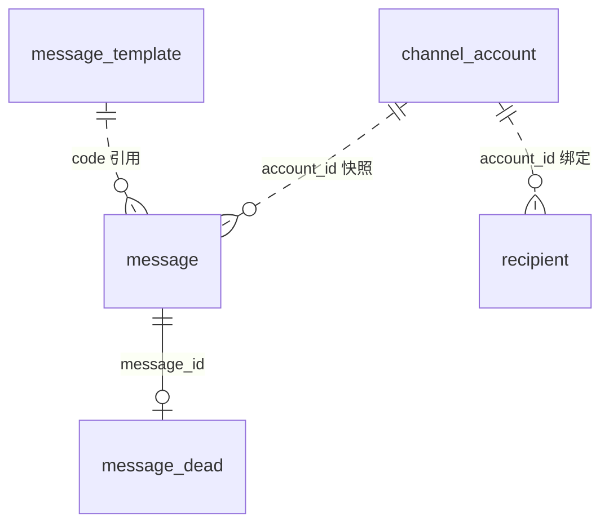
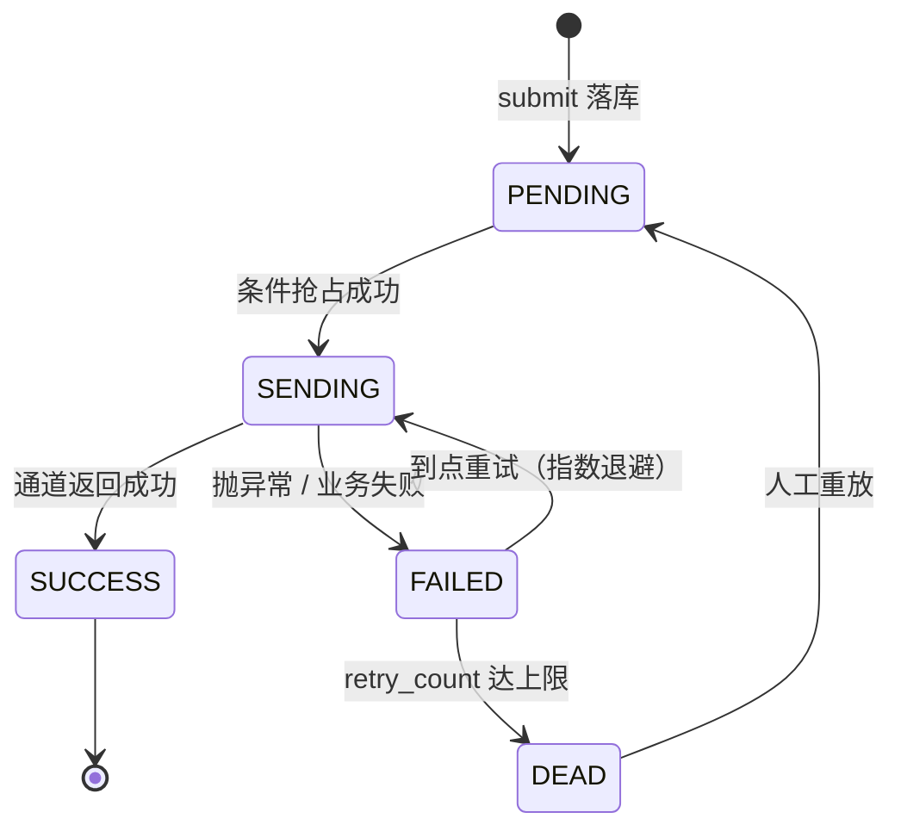

# 数据库设计

MySQL 8.0 / InnoDB / utf8mb4。五张表，核心只有一张 `message`，
其余四张分别是它的模板、死信、接收方配置和通道凭据。

建表语句见 [`sql/schema.sql`](../sql/schema.sql)，增量变更见
[`sql/migration-001-channel-account.sql`](../sql/migration-001-channel-account.sql)。

## 表清单

| 表 | 职责 | 增长量级 |
|---|---|---|
| `message` | 业务消息主体，可靠投递的地基 | **百万级，唯一高速增长的表** |
| `message_template` | 按 `code + channel` 取模板 | 百级，基本不变 |
| `message_dead` | 重试耗尽、需人工介入的消息 | 与失败率成正比，通常很小 |
| `recipient` | 接收方地址簿 | 千级 |
| `channel_account` | 公众号 / 企业微信凭据 | 个位数 |

## ER 图

实线是强关联（死信一定有原消息），虚线是弱关联（模板改了不影响已发的消息，
账号删了历史消息仍保留 account_id）。

---

## message

| 字段 | 类型 | 说明 |
|---|---|---|
| `id` | BIGINT PK | |
| `biz_id` | VARCHAR(64) | 业务唯一键（订单号等），与 `channel` 组成幂等键 |
| `biz_type` | VARCHAR(32) | 业务类型，便于按维度排查与统计 |
| `channel` | VARCHAR(16) | INBOX / SMS / WECHAT_WORK / WECHAT_MP |
| `receiver` | VARCHAR(128) | 接收方地址（手机号 / 用户 ID / openid） |
| `account_id` | BIGINT 可空 | **投递时的账号快照**，为空表示走全局配置 |
| `title` | VARCHAR(128) | 可空 |
| `content` | TEXT | **渲染后的最终内容**，落库后不再变 |
| `status` | VARCHAR(16) | PENDING / SENDING / SUCCESS / FAILED / DEAD |
| `retry_count` | INT | 已重试次数 |
| `max_retry` | INT | 该条消息的重试上限（默认 3） |
| `next_retry_time` | DATETIME | 下次可投递时间，指数退避的落点 |
| `fail_reason` | VARCHAR(500) | 最近一次失败原因 |
| `sent_at` | DATETIME | 发送成功时间 |
| `create_time` / `update_time` | DATETIME | |
| `deleted` | TINYINT | 逻辑删除 |

### 索引逐个说明

| 索引 | 服务的查询 | 为什么这么建 |
|---|---|---|
| `uk_biz_channel(biz_id, channel)` | **幂等地基**：同一业务同一通道只允许一条 | 重复提交由唯一键挡掉，捕获 `DuplicateKeyException` 后返回已有记录，不需要分布式锁，也没有"先查后插"的竞态窗口 |
| `idx_status_retry(status, next_retry_time)` | 补偿扫描：`WHERE status=? AND next_retry_time<=? ORDER BY next_retry_time` | **两列顺序不能反**。先用低基数的 `status` 缩小到一个分区（只有 PENDING/FAILED 会被扫），再按时间有序取，连排序都省了 |
| `idx_receiver_time(receiver, create_time)` | 按接收方查历史、限流命中统计 | 排查"某人为什么没收到"时的第一入口 |

> `idx_status_retry` 是最关键的一条。补偿任务每 200ms~5s 跑一次，
> 是全库最频繁的查询。如果没有这个索引，每次都是全表扫 + filesort，
> 消息表上百万行时直接把数据库打满。

### 状态机

两个关键设计：

- **`PENDING → SENDING` 用条件更新抢占**：`UPDATE ... SET status='SENDING' WHERE id=? AND status IN ('PENDING','FAILED')`，
  影响行数为 1 才继续投递。即时投递和补偿任务可能同时盯上同一条消息，这一步保证只有一个真正发出去。
- **中途崩溃会留下 `SENDING`**：进程被 kill 时消息卡在 SENDING，
  靠 `next_retry_time` 超时后被补偿任务重新捡起（见 `DeliveryWorker`）。

---

## message_dead

| 字段 | 类型 | 说明 |
|---|---|---|
| `id` | BIGINT PK | |
| `message_id` | BIGINT | 指向原消息 |
| `biz_id` / `channel` / `receiver` | | 冗余快照，方便不 join 直接看 |
| `content` | TEXT | 当时的最终内容 |
| `retry_count` | INT | 重试了几次才放弃 |
| `fail_reason` | VARCHAR(500) | 最后一次失败原因 |
| `create_time` | DATETIME | 进死信的时间 |

索引：`idx_message(message_id)` 用于回查原消息，`idx_biz(biz_id)` 用于按业务键批量排查。

> **为什么单独建表，而不是在 `message` 里标成 DEAD？**
>
> 死信是"需要人介入"的状态，和自动重试的失败消息性质不同：
> 单独一张表才能独立告警、独立导出、独立清理。
> 如果混在 `message` 里，每次查死信都要 `WHERE status='DEAD'` 扫一张百万行的表。
>
> 注意这里**不做强一致**：`message` 标 DEAD 和写 `message_dead` 在同一个事务里，
> 但死信表没有反向外键，重放时删死信 + 重置消息状态也在同一事务。

---

## message_template

| 字段 | 类型 | 说明 |
|---|---|---|
| `id` | BIGINT PK | |
| `code` | VARCHAR(64) | 模板编码，如 `ORDER_PAID` |
| `channel` | VARCHAR(16) | 同一编码在不同通道可以有不同的文案 |
| `title` / `content` | | 支持 `${var}` 占位符 |
| `deleted` | TINYINT | 逻辑删除 |

索引：`uk_code_channel(code, channel)`。取模板就是这一条查询，唯一索引顺带保证不会配重复。

> 模板不做版本管理：消息落库的是**渲染后的最终内容**，
> 模板后来怎么改都不影响已发出的消息。这是有意的——
> 排查历史问题时看到的必须是当时真正发出去的文字。

---

## recipient

| 字段 | 类型 | 说明 |
|---|---|---|
| `id` | BIGINT PK | |
| `name` | VARCHAR(64) | 对象名称，如「张三」「运维告警群」 |
| `channel` | VARCHAR(16) | 通道类型 |
| `address` | VARCHAR(128) | 该通道下的地址 |
| `account_id` | BIGINT 可空 | 绑定的通道账号，为空回落全局配置 |
| `remark` | VARCHAR(255) | |
| `deleted` | TINYINT | 逻辑删除 |

索引：`uk_name_channel(name, channel)` 挡重名，`idx_create_time` 供列表排序。

> 同一个人要收短信和站内信，就是两条记录——因为**地址本身不同**
> （站内信用 userId，短信用手机号）。用一张表 + 通道字段表达，比两个字段列在一行里清晰。

---

## channel_account

| 字段 | 类型 | 说明 |
|---|---|---|
| `id` | BIGINT PK | |
| `name` | VARCHAR(64) | 账号名称 |
| `channel` | VARCHAR(16) | WECHAT_MP / WECHAT_WORK |
| `app_id` / `app_secret` / `template_id` | | 公众号凭据 |
| `webhook_url` | VARCHAR(512) | 群机器人地址 |
| `enabled` | TINYINT | 停用后绑定它的消息明确失败，不静默回落 |
| `deleted` | TINYINT | 逻辑删除 |

索引：`uk_account_name_channel(name, channel)` 防重名，`idx_account_channel(channel)` 供按通道筛选。

> **`app_secret` 明文存库只适用于本地演示。** 生产环境应换成 KMS / Vault 或加密列，
> 并且列表接口必须脱敏——当前实现里 `ChannelAccountVO` 不下发 `appSecret`，
> webhook 只给掩码，另用 `secretConfigured` 标志表示"配了但不给你看"。

---

## 关键取舍

### 1. 幂等建在唯一键上，不建在应用逻辑里

`uk_biz_channel(biz_id, channel)` 是整套可靠投递的地基。

应用层"先查后插"在并发下必然有窗口；加分布式锁又要处理锁超时和续期。
把约束交给数据库，代码只需要 `try { insert } catch (DuplicateKeyException) { return 已有记录 }`。

### 2. 补偿扫描索引的列顺序不是随便排的

`idx_status_retry(status, next_retry_time)`：

- 反过来写 `(next_retry_time, status)` 也能用索引，但会先扫时间范围再过滤状态，
  随着历史数据累积，扫的行数只会越来越多
- 按 `(status, next_retry_time)` 建，`status` 只有 5 个取值且被扫的只有 2 个，
  等于先把表切成一小块，块内再按时间有序取

### 3. `account_id` 存快照，不存外键关联

消息上的 `account_id` 是**投递当时**用的账号，不是"当前应该用哪个账号"。

补偿任务可能在进程重启后、甚至几小时后重试这条消息，那时已经没有原始请求上下文了。
如果只存关联关系，账号被改绑就会让这条消息用错凭据发出去。

### 4. 死信独立成表

见上文 `message_dead` 的说明。核心是：**"需要人介入"和"自动重试中"是两种不同的运维语义**，
混在一张表里会让告警、导出、清理都变得别扭。

### 5. 逻辑删除 + 有限使用

`message` / `message_template` / `recipient` / `channel_account` 都带 `deleted`。

但 `message_dead` 和 `submission` 类表不带——死信重放后直接物理删除，
因为它的生命周期就是"被处理掉"。**逻辑删除不是无脑全部加上**，
要按"这条记录被删后还有没有人引用"来判断。
