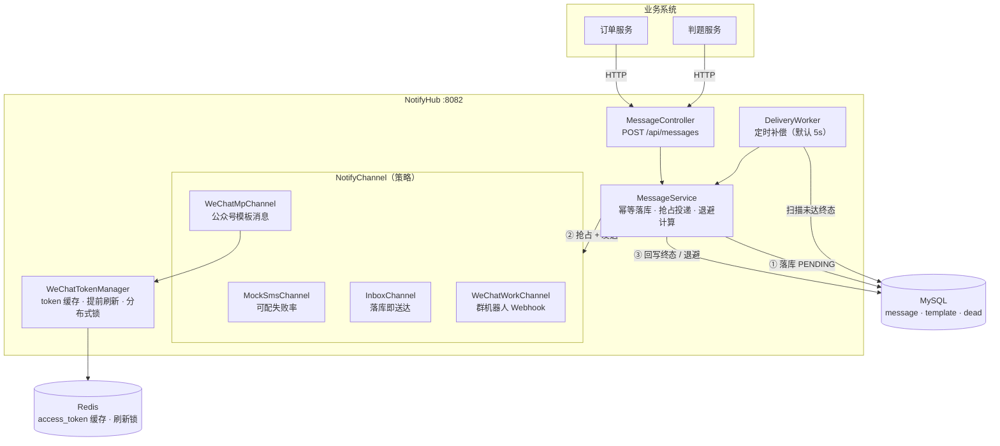
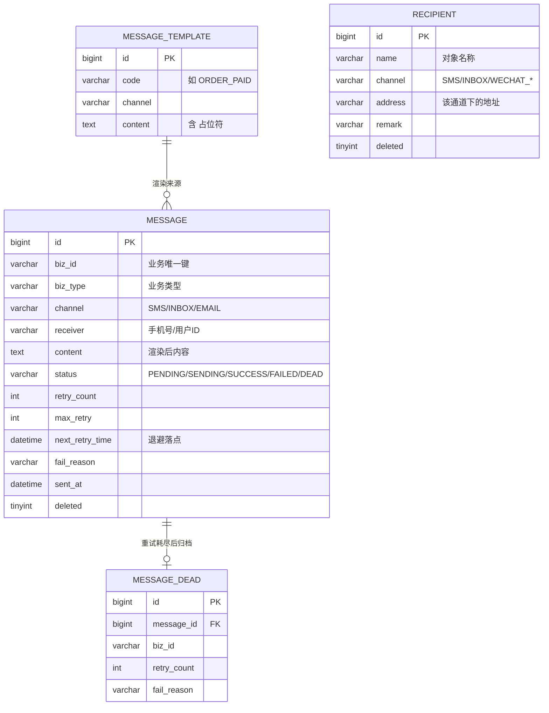
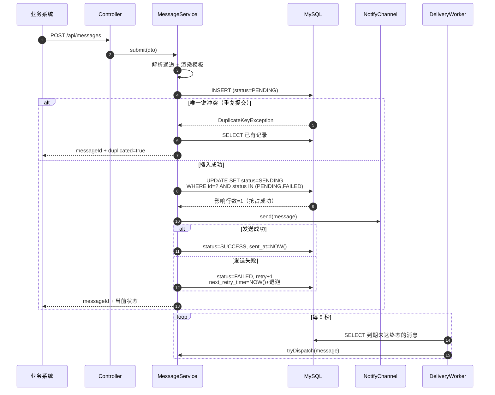
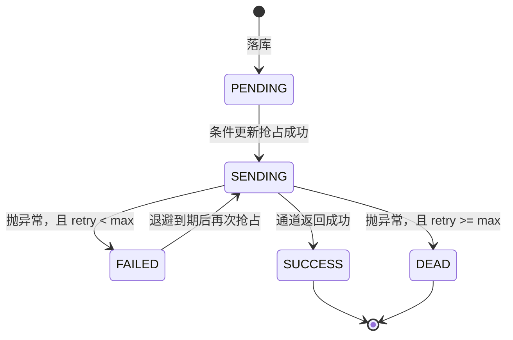
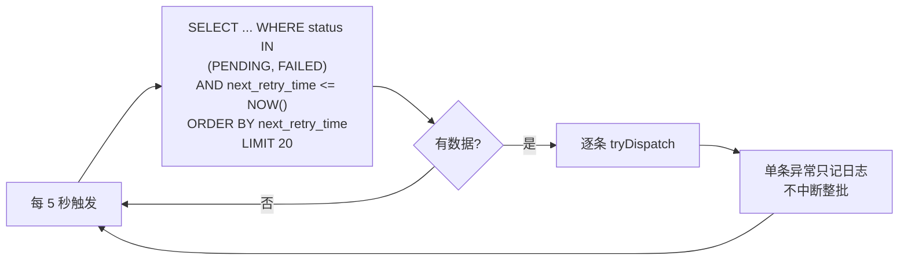
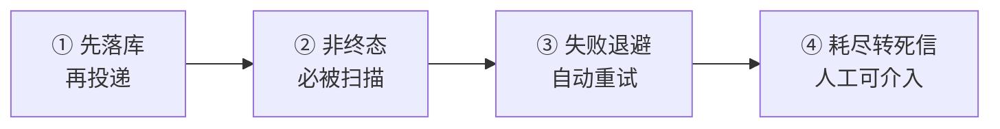

# NotifyHub 设计文档

> 通知中台：一个统一的消息投递服务。业务方调一个接口，它负责把消息可靠地送到短信 / 站内信 / 企业微信 / 公众号。
>
> 状态标记：**[已实现]** 代码已落地并验证；**[待实现]** 属于后续范围。
>
> 配套：本文讲**为什么这么设计**，[../README.md](../README.md) 讲**怎么跑起来**与实测数据。

## 目录

1. [背景与定位](#一背景与定位)
2. [目标与非目标](#二目标与非目标)
3. [整体架构](#三整体架构)
4. [数据模型](#四数据模型)
5. [核心流程](#五核心流程)
6. [关键决策与取舍](#六关键决策与取舍)
7. [可靠性设计](#七可靠性设计)
8. [接口设计](#八接口设计)
9. [已知边界](#九已知边界)
10. [技术亮点](#十技术亮点)

---

## 一、背景与定位

### 1.1 要解决的问题

任何有一定规模的系统都会遇到同一件事：**某个业务动作发生后，需要通知用户**。

订单支付成功要发短信、判题完成要发站内信、账单逾期要发邮件。如果每个业务模块自己对接短信网关、自己处理发送失败、自己记录发送历史，会迅速失控：

| 问题 | 具体表现 |
|---|---|
| 重复对接 | 三个模块各接一次短信 SDK，网关换了要改三处 |
| 可靠性缺失 | 网关超时就直接失败，用户收不到也没人知道 |
| 无法追溯 | 用户投诉没收到，查不出是网关问题还是根本没发 |
| 重复发送 | 业务重试导致同一笔订单发了两条短信，用户反感 |

所以需要一个**统一出口**：业务方只说"给这个用户发这条消息"，剩下的可靠性、重试、追溯、去重都归它管。

### 1.2 与项目一的关系

两个项目刻意做成**互补**而不是重复：

| | CodeJudge（项目一） | NotifyHub（项目二） |
|---|---|---|
| 核心命题 | 任务怎么**高效分发**到执行者 | 消息怎么**保证送达** |
| 可靠性手段 | Redis Stream 消费者组 + XCLAIM 故障转移 | 数据库消息表 + 定时补偿 |
| 失败处理 | 任务丢失后重新认领、重新执行 | 投递失败后退避重试、耗尽转死信 |
| 数据载体 | Redis（PEL 管理未确认消息） | MySQL（状态机管理投递生命周期） |

两者的区别不是"用没用队列"，而是**可靠性建立在哪个存储上**：项目一信任 Redis 的 PEL，项目二信任数据库的状态字段。这个对比本身就是理解两种可靠性的好切入点（见 [6.1](#61-为什么不用-mq)）。

---

## 二、目标与非目标

### 2.1 目标

| # | 目标 | 验收标准 |
|---|---|---|
| G1 | 业务方一次调用即可发送 | `POST /api/messages` 返回 messageId |
| G2 | 同一业务同一通道只发一次 | 重复提交返回 `duplicated=true`，不产生新记录 |
| G3 | 投递失败自动重试 | 指数退避，可配置最大次数 |
| G4 | 重试耗尽可追溯 | 转入死信表，含失败原因与重试次数 |
| G5 | 通道可插拔 | 新增通道只加一个实现类，主流程不动 |
| G6 | 进程崩溃不丢消息 | 重启后补偿任务继续处理未达终态的消息 |

### 2.2 非目标（明确不做）

限定范围是设计的一部分。以下内容**明确不做**，避免半成品拖垮核心链路：

| 不做 | 原因 |
|---|---|
| 邮件通道 | 需要 SMTP 配置与发信域名备案，投入产出比低；通道抽象已被四个实现验证，再加一个纯属体力活 |
| 模板引擎（Freemarker / Velocity） | 通知只需要变量替换，引入模板引擎反而带来 SSTI 风险 |
| 控制台的复杂前端功能（权限体系、多租户、可视化编排） | 控制台只服务主链路：发送、按业务键查全通道、死信重放、发送对象与通道账号管理。**多账号 ≠ 多租户**：前者是同一个人管理多套凭据，后者涉及数据隔离与权限体系，成本完全不同 |
| 通道降级（短信失败转站内信） | 属于策略层，先把可靠性做扎实 |
| 优先级队列 | 通知场景对延迟不敏感，VIP 消息可以用独立队列解决 |
| 分库分表 | 单表百万级以内不需要 |

---

## 三、整体架构



**四个通道的能力差异**：

| 通道 | 接收方 | 前置依赖 | 真实可发 |
|---|---|---|---|
| `SMS` | 手机号 | 短信网关 | Mock（模拟失败率） |
| `INBOX` | 用户 ID | 无 | 落库即送达 |
| `WECHAT_WORK` | 群 | Webhook URL | ✅ 配了就能真发 |
| `WECHAT_MP` | openid | AppID + Secret + 模板 ID | 无资质时 Mock |

**三层职责**：

| 层 | 职责 | 不该做的事 |
|---|---|---|
| `Controller` | 参数校验、返回统一响应 | 不碰业务逻辑 |
| `MessageService` | 状态流转、幂等、退避计算 | 不关心通道怎么实现 |
| `NotifyChannel` | 只负责"把这条消息送出去" | 不关心重试与状态 |

> **为什么 Service 和 Channel 要分开**：通道的差异极大（HTTP 调用 / 纯落库），而**重试逻辑对所有通道都一样**。
> 如果让通道自己重试，每个实现都要写一遍退避算法，且无法统一控制重试上限。

---

## 四、数据模型

> 完整的字段清单、索引设计与状态机见 **[DATABASE.md](DATABASE.md)**；这一节只讲建模思路。



> `recipient`（发送对象）与其他四张表**没有外键关系**：它是「发给谁」的地址簿，
> 而 `message` 里存的 `receiver` 是**发送当时的地址快照**。
> 二者刻意解耦——对象改名或改手机号，历史消息必须保持原样，否则排查时会串。

### 4.1 三个关键设计
**① 消息体与任务状态合在一张表**

没有拆成 `message`（内容）+ `message_task`（投递任务）两张表。理由：通知的消息体很小（一条短信几十字节），拆开后反而引入"内容与状态不同步"的一致性问题——比如消息体写完、任务没建，这条通知就永远不会被投递。

**② 幂等键做成唯一索引，而不是查重逻辑**

```sql
UNIQUE KEY uk_biz_channel (biz_id, channel)
```

这样幂等由数据库保证，不需要"先 SELECT 再 INSERT"（并发下有竞态窗口），也不需要分布式锁。

**③ 补偿扫描索引的两列顺序不能反**

```sql
KEY idx_status_retry (status, next_retry_time)
```

对应查询 `WHERE status IN ('PENDING','FAILED') AND next_retry_time <= NOW()`。
如果建成 `(next_retry_time, status)`，状态过滤会用不上索引，扫描范围变成"全表所有到期时间"。

---

## 五、核心流程

### 5.1 发送时序



### 5.2 状态机



**状态只能单向流转**，`PENDING / FAILED → SENDING` 靠条件更新保证同一条消息同时只有一个线程在投递。

### 5.3 补偿扫描



## 六、关键决策与取舍

这一节是整份文档最重要的部分——**代码怎么写是次要的，为什么这么写才是关键**。

### 6.1 为什么不用 MQ

这是最容易被问的问题。用 Kafka / RabbitMQ 也能实现可靠投递，为什么不用？

| 维度 | MQ 方案 | 数据库消息表方案（本项目） |
|---|---|---|
| 可靠性来源 | Broker 的持久化 + ACK 机制 | 数据库事务 + 状态字段 |
| 延迟 | 毫秒级 | 最多一个扫描间隔（默认 5s） |
| 运维成本 | 多一个中间件 | 无 |
| 可观测性 | 需要额外的管理界面 | 一条 SQL 就能查"卡住了多少条" |
| 消息积压 | Broker 背压，可能撑爆磁盘 | 表变大，加索引即可 |
| 事务一致性 | 需要事务消息 / 本地消息表 | 本身就是本地消息表 |

**结论**：通知场景对延迟不敏感（用户不会介意短信晚 5 秒），但要求"绝对不能丢"和"出问题能查"。
数据库方案在这两点上更强，且少一个中间件。

**代价要主动说**：扫描间隔带来延迟上限；高频轮询对数据库有压力（表大后要改成"按时间分片扫描"或缩短批次）。

> 如果换成订单创建这种强实时场景，应该改用 MQ 或事务消息——**这是取舍，不是绝对正确**。

### 6.2 幂等为什么用唯一键，而不是"先查后插"

最直觉的写法：

```java
// ✗ 有竞态窗口
if (mapper.exists(bizId, channel)) {
    return existing;
}
mapper.insert(message);
```

两个并发请求可能**同时**查到"不存在"，然后都插入，于是同一条通知发了两遍。

正确做法是让数据库来保证：

```java
try {
    messageMapper.insert(message);
} catch (DuplicateKeyException e) {
    // 唯一键挡住了，说明已经存在
    return existing;
}
```

**为什么不用分布式锁**：唯一键是数据库自带的能力，零额外成本、零锁超时、零脑裂风险。能用唯一键解决的幂等问题，不要上锁。

### 6.3 抢占为什么用条件更新

```sql
UPDATE message SET status='SENDING'
WHERE id=? AND status IN ('PENDING','FAILED')
```

**影响行数就是抢占结果**：1 表示抢到了，0 表示别人先到。

这和项目一判题任务的抢占是同一个思路（`WHERE status='PENDING'`），区别只是那边靠 Redis Stream 投递、这边靠定时扫描，所以并发冲突更容易发生，条件更新更不能省。

### 6.4 退避时间为什么必须用数据库时间

**这是实测发现的真实 bug，不是理论担忧。**

第一版代码用 Java 算退避：

```java
LocalDateTime nextTime = LocalDateTime.now().plusSeconds(delay);
```

跑通后查数据发现：

```
sent_at      = 16:14:31     ← MySQL 的 NOW()
create_time  = 16:14:32     ← JVM 的 LocalDateTime.now()
```

**发送时间比创建时间还早 1 秒**，说明两个时钟源不同步。

危害不止显示难看：

- `selectDue()` 用 MySQL 的 `NOW()` 判断是否到期
- 如果 `next_retry_time` 用 JVM 时间写入，而 JVM 比 DB 慢 1 秒，消息就会**晚 1 秒才被重试**
- 服务器时钟漂移严重时（NTP 未同步），可能永远不触发重试

修复：让数据库算

```java
.setSql("next_retry_time = DATE_ADD(NOW(), INTERVAL " + delaySeconds + " SECOND)")
```

**原则**：凡是参与"时间比较"的字段，写入和比较必须用同一个时钟源。

### 6.5 站内信为什么不建额外的表

站内信的本质是"存一条记录给用户看"，而 `message` 表已经存了内容和接收方。所以：

- `InboxChannel.send()` 几乎什么都不做
- 状态变成 `SUCCESS` 后，用户查 "channel=INBOX AND receiver=me AND status=SUCCESS" 就是"我的消息"

**好处**：少一张表、少一次写入、不存在"消息表写了但收件箱没写"的一致性问题。
**代价**：没有已读/未读状态（需要时加一个 `read_at` 字段即可）。

### 6.6 定时任务用 fixedDelay 而不是 fixedRate

```java
@Scheduled(fixedDelayString = "${notify.worker.scan-interval-ms:5000}")
```

| 方式 | 行为 | 风险 |
|---|---|---|
| `fixedRate` | 每 5s 触发一次，不管上次跑完没 | 通道变慢时任务堆积，线程池被占满 |
| `fixedDelay`（本项目） | 上次**跑完**后等 5s 再触发 | 间隔会被拉长，但不会堆积 |

通知场景可以容忍间隔变长，不能容忍堆积。

---

### 6.7 微信 access_token 为什么必须专门管理

短信通道是无状态的（每次带 API Key 就行），微信不是。发公众号模板消息前必须先换 `access_token`，而它有三条和短信完全不同的约束：

| 约束 | 忽略它的后果 |
|---|---|
| **全局唯一** | 同一 AppID 只有一个有效 token，新换的会让旧的**立刻失效** |
| **有效期 7200 秒** | 过期即不可用 |
| **换 token 接口有配额** | 每日约 2000 次，频繁刷新会烧光 |

所以「每次发消息前换一次 token」在单机上能跑，一上生产就出事：

- 三个实例各换各的 → 互相踢掉对方的 token → **全部发送失败**
- 每条消息换一次 → 几百条消息就把当天配额用光

#### 本实现的四层策略

**① Redis 缓存，多实例共享**

token 存在 Redis，任何实例读同一份，不存在互相踢。

**② 提前 5 分钟刷新**

缓存 TTL 取 `expires_in - 300`。不提前的话，会在「缓存已过期但 token 还有效」和「token 也过期」之间反复横跳，临界点必然有失败请求。

**③ 分布式锁，只让一个实例去换**

缓存失效的瞬间多个实例会同时发现没 token。用 `SETNX` 抢锁，抢到的去换，其余等 500ms 后重读缓存：

```java
Boolean locked = redis.opsForValue().setIfAbsent(LOCK_KEY, "1", LOCK_TTL);
if (!Boolean.TRUE.equals(locked)) {
    sleep(500);
    return redis.opsForValue().get(TOKEN_KEY);   // 别人应该已经刷好了
}
```

锁 TTL 30 秒——即使持有者崩溃也会自动释放，不会死锁。

**④ 刷新失败不清缓存**

网络抖动导致换 token 失败时，旧 token 可能还有效。直接清掉等于把整条通道打死；保留它，下次发送还能用，失败则走正常重试。

#### 错误码决定重试策略

微信的 HTTP 状态码**永远是 200**，成功失败要看 `errcode`。不同错误码必须区别对待：

| errcode | 含义 | 处理 |
|---|---|---|
| `40001` / `42001` | token 失效 | 清缓存，**立即重试一次**（重试前换了新 token，成功率高） |
| `45009` | 调用频率超限 | **不能立即重试**，抛异常交给外层指数退避 |
| 其他 | 参数 / 模板错误 | 直接失败，进入正常重试队列 |

`45009` 这条最关键：频率超限时立即重试只会更超限，必须让上层的退避机制接管。

---

### 6.8 限流为什么用固定窗口，而不是令牌桶

通知中台必须限流，理由有三个层次：

| 理由 | 说明 |
|---|---|
| **短信轰炸** | 有人刷接口给同一手机号发几百条，既烧钱又会被投诉 |
| **成本** | 短信按条计费，站内信免费——通道之间成本差几十倍 |
| **通道配额** | 微信有日调用上限，打爆了当天全站都发不出去 |

**为什么不用令牌桶**（项目一用的是令牌桶）：令牌桶控制的是**速率**（每秒 N 个），适合限 QPS；
通知场景要控制的是**总量**——「同一手机号每分钟最多 5 条」在语义上就是固定窗口计数。

```lua
local current = redis.call('INCR', KEYS[1])
if current == 1 then
  redis.call('EXPIRE', KEYS[1], ARGV[2])   -- 只在窗口内第一次设过期
end
if current > tonumber(ARGV[1]) then return 0 end
return 1
```

`INCR` 与 `EXPIRE` 在同一个脚本里执行，不会出现「加了计数但没设过期」导致 key 永久驻留。

**已知缺陷（必须主动说）**：固定窗口在边界有**双倍突发**——
第 59 秒发 5 条、第 61 秒再发 5 条，两秒内实际发了 10 条。
要彻底解决得用滑动窗口（ZSet 或 Redis Cell），代价是内存与复杂度上升。

#### 限流位置：为什么放在"幂等快查"之后

顺序是刻意的：

```
① 幂等快查（已存在直接返回，不消耗配额）
② 限流检查
③ 落库 + 投递
```

如果先限流再判幂等，调用方**重试同一个 bizId** 时也会吃配额——
重试 5 次就把该用户当分钟的额度耗光，而这 5 次里只有一次真正发送。

**实测验证**：同一 bizId 连发 7 次（限额 5/分钟），全部返回 `duplicated=true` 且无一次 429；
若顺序反了，第 6 次就会被拒。

**降级**：Redis 故障时兜底放行。限流是保护措施，失效不应让整条链路不可用——
与项目一令牌桶的取舍一致。

---

### 6.9 失败处理为什么单独拆成一个 Bean

原本 `markFailed` 是 `MessageService` 的一个方法，带 `@Transactional`，由同类内的 `tryDispatch` 直接调用：

```java
// 错误写法：this.markFailed(...) 不经过 Spring 代理，@Transactional 完全不生效
public void tryDispatch(Message m) {
    try { channel.send(m); }
    catch (Exception e) { markFailed(m, e.getMessage()); }
}

@Transactional(rollbackFor = Exception.class)
public void markFailed(Message m, String reason) { ... }
```

`@Transactional` 的实现是 AOP 代理：外部调用先进代理，代理开事务再进目标方法。
而 `this.markFailed()` 是对象内部调用，**根本不经过代理**——注解形同虚设。

后果不是"少个事务"这么轻：这个方法里有两步写库

```
① UPDATE message SET status='DEAD' ...
② INSERT INTO message_dead ...
```

没有事务时两步各自提交，中途失败（连接断、超时、唯一键冲突）会出现：

- 消息已置 `DEAD`、死信表没记录 → 死信列表里找不到，看起来像"消息凭空消失"
- 或者在重试分支里：`status` 改了但 `next_retry_time` 没改 → 消息永远等不到下一次投递

**修法**：把这段逻辑搬到独立的 `MessageFailureHandler`。
跨 Bean 调用必然经过代理，事务才真正生效。

这条比"我用了 @Transactional"值钱得多——它说明知道注解的生效条件，
而不是以为加了注释就有事务。

---

### 6.10 前端为什么从「单文件 HTML」拆成独立工程

第一版控制台是 `src/main/resources/static/admin.html`，一个文件、原生 JS、没有构建。
当时的选择是对的：一个管理页不值得引入 Vite + node_modules + 构建步骤。

后来拆成独立工程，是因为三件具体的事，而不是"为了前后端分离而分离"：

| 触发点 | 单文件方案的代价 |
|---|---|
| 页面要展示的消息字段越来越多（状态、重试次数、下次重试时间、失败原因、多通道对比） | 手写 `innerHTML` 拼接，字段一多就容易漏转义，而内容来自用户输入，漏一处就是存储型 XSS |
| 「发送成功后自动按该 bizId 查询」这类联动 | 靠 `document.getElementById` 直接操作 DOM，逻辑散在全局函数里 |
| 前端产物打进 jar | 改一行文案就要重新 `mvn package`，前后端发布节奏被绑死 |

拆开之后的变化：

```
frontend/          ← 独立工程，Vue3 + TS + Vite
├── src/api/index.ts         axios 拦截器统一解包「HTTP 200 + 业务 code」
├── src/types.ts             与后端 DTO 对齐的类型
├── src/components/          SendForm / BizQuery / DeadLetter / MessageTable
└── vite.config.ts           dev 代理 /api → 8082
```

**三个配套决策**：

1. **dev 端口用 5174 而不是 5173**——5173 留给了同机的另一个项目，两个项目同时开不会打架；
2. **开发走 Vite proxy，不改后端**——前端代码里只出现相对路径 `/api`，换环境不用改代码；
3. **后端仍要配 CORS**——proxy 只解决开发时的问题，部署到 nginx / CDN 后浏览器直连 API 域名，
   预检请求由后端放行。来源做成 `NOTIFY_CORS_ORIGINS` 可配，**没有写成 `*`**：
   将来一旦加上 Cookie 或鉴权头，通配来源与凭据不能共存，且等于允许任何站点拿用户的浏览器当跳板。

代价也要说清楚：多了一套 `node_modules`、构建步骤，以及"先起后端再起前端"的启动顺序。
这正是当初选择单文件的原因——**同一个决策在不同阶段有不同答案**，关键在于触发点是什么。

### 6.11 多通道账号：凭据为什么必须入库

第一版把 `appId / appSecret / templateId` 放在 `application.yml`，启动时注入成单例。
这在只有一个测试号时完全够用，但「通知中台」要接第二个公众号就露馅了：
改配置、重启、而且无法在管理台里切换——用户问的正是这一点。

改造后凭据变成 `channel_account` 表，对象绑定账号，消息记录账号快照。
三个容易做错的地方：

**① `message.account_id` 必须落库，不能只在内存里传**

投递是异步的：消息先落 `PENDING`，补偿任务可能几小时后、甚至在**另一个进程**里重试。
那时没有原始请求上下文，若消息不带账号，就不知道该用哪套凭据。
`recipient` 上也有 `account_id`，但对象可能被改绑或删除，所以消息存的是**投递当时的快照**。

**② token 缓存与锁的 key 必须带 appId**

原来是全局常量 `wechat:mp:access_token`。两个公众号共用时：
A 刷新 → 覆盖 → B 拿 A 的 token → 40001 → B 清缓存 → A 的 token 也被清掉 → 互相踢。
改成 `wechat:mp:token:{appId}` 和 `wechat:mp:token:lock:{appId}` 后，
每个号各有一份独立 token、独立刷新锁，原来那套 SETNX 防并发的逻辑不用改，只是多了个维度。

**③ 账号没了不能静默回落到全局配置**

账号被删除或停用，绑定它的消息应该**明确失败并进死信**，而不是悄悄改用全局账号发到另一个公众号。
后者会把消息发给错误的对象，比失败严重得多。
同理，通道不匹配的绑定要在对象写入时就被拒（前端过滤只是体验，后端必须再校验一次）。

**安全边界**：管理台目前无鉴权，所以列表接口返回 `ChannelAccountVO`——
不含 `appSecret`，webhook 只给掩码，另用 `secretConfigured` 标志表示「配了但不给你看」。
编辑时密钥留空表示保持原值，否则「改个备注」会把密钥清空。
明文存库仅适用于本地演示，生产应接 KMS / 加密列（已列进第九章）。

**兼容**：`account_id` 可空，为空就走全局配置。
老数据、已有脚本、以及 `tools/fake_webhook.py` 那类把完整 URL 写在地址里的用法都不受影响——
新增能力不应该要求迁移历史数据。

---

## 七、可靠性设计

### 7.1 "不丢"的四道保障



| # | 保障 | 防的是什么 |
|---|---|---|
| ① | 落库先于投递 | 先调网关再写库，中途崩溃就不知道发没发 |
| ② | 只要状态不是 SUCCESS/DEAD，就一定会被扫到 | 投递失败后没人管 |
| ③ | 指数退避重试 | 网关抖动导致的一次性失败 |
| ④ | 死信表 | 重试也救不回来的消息被静默丢弃 |

### 7.2 "不重"的三层

| 层 | 手段 | 防的是什么 |
|---|---|---|
| 接口层 | `bizId` 必填（`@NotBlank`） | 调用方乱传，幂等无从谈起 |
| 存储层 | `uk_biz_channel` 唯一索引 | 并发重复提交 |
| 投递层 | 条件更新抢占 | 定时扫描与即时投递同时处理同一条消息 |

### 7.3 已实测的行为

| 场景 | 结果 |
|---|---|
| 站内信发送 | `SUCCESS`，内容渲染正确 |
| 短信发送（fail-rate=0.3） | 常态成功；失败时进入 `FAILED` 并记录原因 |
| 重复提交同一 bizId+channel | 返回原 messageId，`duplicated=true`，库里只有一条 |
| 强制失败（fail-rate=1.0, max-retry=2） | `FAILED(retry=1)` → 退避 2s → `DEAD(retry=2)`，死信表落库 |
| 重试的执行线程 | `notify-dispatch`（补偿线程池），不是 HTTP 线程 |
| 50 个并发请求打同一 bizId | 只落库 1 条，49 次返回 `duplicated=true` |
| 1000 条并发投递 | 日志中"投递成功"恰好 1000 条，无重复 `messageId` |

### 7.4 性能实测

单机、MySQL 同机、mock 通道 `latency-ms=20`（模拟网关往返）。

**提交链路**

| 指标 | 结果 |
|---|---|
| 吞吐（20 并发 / 1000 条） | 249 条/秒 |
| 延迟 P50 / P90 / P99 | 66ms / 96ms / 328ms |

**补偿扫描吞吐**（真正的瓶颈）

| 配置 | 吞吐 | 相对基线 |
|---|---|---|
| batch=20，串行，间隔 500ms | 16.6 条/秒 | — |
| 双实例，均串行 | 22.4 条/秒 | +35% |
| batch=20，**批内并发 8** | 29.4 条/秒 | +77% |
| batch=100，并发 16，间隔 200ms | **171 条/秒** | **10.2 倍** |

这张表最重要的结论是**第二行**：加实例只提升 35%，因为瓶颈不在实例数，而在单线程串行调用通道——
单条投递 90% 时间在等网关返回，线程全程阻塞，加机器只是多几把椅子，每个人还是站着排队。

改成批内并发后吞吐提升 77%；再调大 `batch-size` 让线程池跑满、缩短间隔，达到 171 条/秒。

吞吐近似公式：

```
吞吐 ≈ batch-size / (⌈batch-size / concurrency⌉ × 单条耗时 + scan-interval)
```

据此可以反推配置：真实短信网关 200ms 时，若要求 100 条/秒，
应取 `concurrency × 1000 / 200 = 5 × concurrency ≥ 100`，即并发至少 20。


---

## 八、接口设计

### 8.1 发送消息

```
POST /api/messages
Content-Type: application/json

{
  "bizId": "ORDER-20261106-001",     // 必填，幂等键
  "bizType": "ORDER_PAID",           // 必填，业务类型
  "channel": "SMS",                  // 必填，SMS / INBOX
  "receiver": "13800138000",
  "templateCode": "ORDER_PAID",      // 与 content 二选一
  "vars": { "orderNo": "A1001", "amount": "99.00" }
}
```

响应：

```json
{
  "code": 0,
  "message": "成功",
  "data": {
    "messageId": 1,
    "status": "SUCCESS",
    "duplicated": false     // true 表示命中了幂等
  }
}
```

### 8.2 查询消息状态

```
GET /api/messages/{id}      → 单条状态（含 retryCount / nextRetryTime / failReason）
GET /api/messages?bizId=xx  → 该业务下所有通道的消息
```

**为什么提供按 bizId 查**：排查"用户说没收到"时，需要一次看清短信是否成功、站内信有没有落库。

### 8.3 错误码

| code | 含义 |
|---|---|
| 0 | 成功 |
| 400 | 参数错误（通道不支持、模板不存在、必填项缺失） |
| 500 | 系统异常 |

---

## 九、已知边界

诚实列出，避免误判成熟度。

| 项 | 现状 | 影响 |
|---|---|---|
| **补偿延迟** | 受 `scan-interval-ms` 限制（默认 5s），不是实时投递 | 对时效敏感的通知需要调小间隔或首次失败即重排 |
| **多实例扫描重叠** | 每个实例都会 `selectDue`，靠条件更新避免重复投递 | 实测双实例只提升 35%，存在无效竞争；应改用 `SKIP LOCKED` 批量抢占 |
| **无优先级** | 所有消息同一批次处理 | VIP 通知无法插队 |
| **固定窗口的双倍突发** | 窗口边界处实际可发 2 倍量 | 精确控制需换滑动窗口（ZSet / Redis Cell） |
| **通道限流是全局的** | 短信与站内信共用 100/分钟 | 实际应按通道分别配置 |
| **无监控指标** | 只有日志，没有 QPS / 成功率 / 积压量 | 无法接 Prometheus |
| **无通道降级** | 短信失败不会自动转站内信 | 用户可能完全收不到 |
| **无鉴权** | 管理台与 API 均无登录 | 只能内网部署 |
| **微信无资质时走 Mock** | 未配置 AppID/Secret 时只打日志不真调 | 链路可验证，但无法证明真实到达率 |
| **公众号模板是固定结构** | `first / content / remark` 三字段写死 | 不同模板字段不同，要改成配置化 |
| **账号密钥明文存库** | 演示用，列表接口已脱敏但未接 KMS / 加密列 | 生产需换密钥管理，并给管理台补鉴权 |
| **账号维度限流缺失** | 限流仍按接收方 + 全局通道，不区分账号 | 多账号共用一个通道配额时可能互相挤占 |
| **单库** | 消息表随量增长需要归档 | 按月分区或冷热分离 |

> **已解决的边界（保留记录，说明取舍会随阶段变化）**：
> 「token 单 AppID / 只支持一个公众号」曾列在这里。改造后凭据入库为 `channel_account`，
> token 缓存与锁的 key 都带 appId，对象可绑定不同账号；详见 6.11。
> 当时不做是对的——第一阶段只有一个测试号，为「可能的第二个号」提前建表属于过度设计；
> 真正触发改造的是「要接第二个公众号」这个具体需求出现。

> 关于"多实例扫描重叠"：错开两个实例的扫描间隔后吞吐仍是 22.3 条/秒（与间隔 500ms 时一致），
> 说明问题不是时间相位碰撞，而是 `selectDue` 的排序是确定性的——多个实例永远盯着同一批消息。
> 标准解法是 `SELECT ... FOR UPDATE SKIP LOCKED`，让数据库直接分配互不重叠的批次。

---

## 十、技术亮点

| # | 亮点 | 一句话价值 |
|---|---|---|
| 1 | **本地消息表 + 定时补偿**实现可靠投递，不依赖 MQ | 少一个中间件，换来"能查能查"的可靠性和可观测性 |
| 2 | **唯一键幂等** + 条件更新抢占，双重防止重复发送 | 不用分布式锁解决并发重复提交 |
| 3 | **指数退避 + 最大重试 + 死信**三段式失败处理 | 抖动自动恢复，永久失败可追溯 |
| 4 | **通道策略模式**，四个实现共用同一套可靠性逻辑 | 短信 / 站内信 / 企业微信 / 公众号只是不同实现，重试与死信全部复用 |
| 5 | **微信 access_token 统一管理**：Redis 缓存 + 提前刷新 + 分布式锁 | 解决多实例互相踢 token 与配额被烧光的问题，是按错误码区分重试策略的典型案例 |
| 6 | 发现并修复**跨时钟源**导致的退避时机错误 | 体现对"时间比较必须同源"的理解，不是书本知识 |
| 7 | **按接收方 / 通道双维度固定窗口限流**，且放在幂等之后 | 重试不吃配额；用固定窗口而非令牌桶，因为要控制总量不是速率 |
| 8 | **定位补偿吞吐瓶颈是"串行调通道"而非实例数**，改批内并发后 16.6 → 171 条/秒 | 用数据否掉"加机器就能扩容"的直觉，先量出瓶颈再优化 |
| 9 | 发现 `markFailed` 的 `@Transactional` 因**自调用不经过代理**而失效，抽成独立 Bean | 知道注解的生效条件，而不是以为加了就有事务 |
| 10 | **33 个单测 + 11 项回归 + 三份压测脚本** | 退避边界、幂等、抢占、限流映射这类只靠人工测不出来的逻辑，全部有断言兜底 |

**一句话概括**：

> 我做了一个通知中台，核心问题是"消息怎么保证一定送到"。
> 我没有用 MQ，而是用数据库消息表加定时补偿——因为通知场景对延迟不敏感，
> 但要能随时用 SQL 查出"现在有多少条卡住了"，这是 MQ 做不到的。
> 可靠性靠四层：先落库再投递、非终态必被扫、失败退避重试、耗尽转死信。
> 不重复靠两层：唯一键挡并发提交，条件更新挡重复投递。
>
> 上线前发现两个坑。第一个：退避时间用 JVM 时间算，而判断到期用 MySQL 的 NOW()，
> 两个时钟源差 1 秒，重试时机就不准了，后来改由数据库计算。
> 第二个：失败处理的 `@Transactional` 其实是失效的——它在同类里被自己调用，
> 不走 Spring 代理，所以"置死信"和"写死信表"可能只成功一半。拆成独立 Bean 才有事务。
>
> 压测时还纠正了一个直觉：我以为补偿慢是因为只有一台机器，结果起第二个实例只快了 35%。
> 一量才发现瓶颈是单线程串行调通道——每条都在等网关返回，线程全在阻塞。
> 改成批内并发后到 29 条/秒，再把批次调到 100、间隔缩到 200ms，稳定 171 条/秒，
> 是原来的 10 倍。

---

*文档随代码演进，如有不符以代码为准。*

